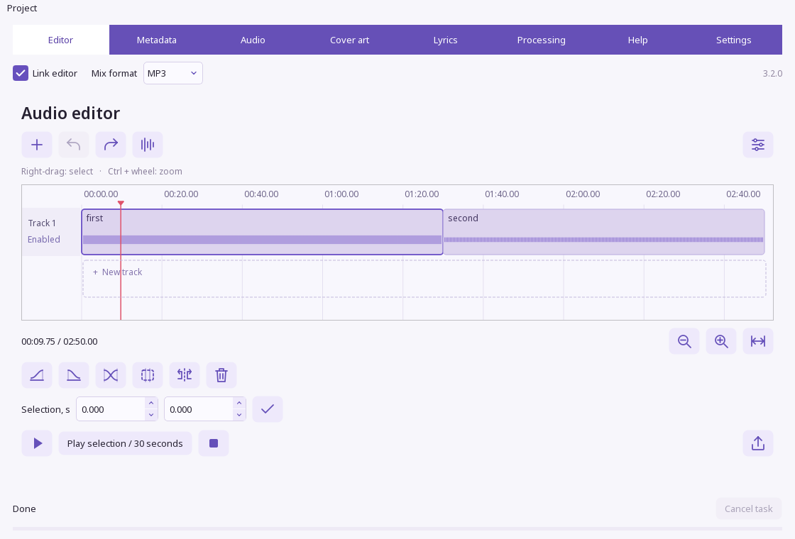

# SonicForge 3.2.0

[RU](README.md) · **English**

An audio editor for Windows with multitrack editing, audio processing, metadata, procedural cover art and synchronized lyrics. Built with **C++20 / Qt 6**, SonicForge runs recognition, lyric alignment and stem separation locally. No Python runtime is required.

## Download

<p>
  <a href="https://github.com/dumuzeyn/SonicForge/releases/download/v3.2.0/SonicForge-Setup.exe"></a>
  <a href="https://github.com/dumuzeyn/SonicForge/releases/download/v3.2.0/SonicForge-windows-x64.zip"></a>
</p>

[SHA-256 checksums](https://github.com/dumuzeyn/SonicForge/releases/download/v3.2.0/SHA256SUMS.txt) · [Release 3.2.0](https://github.com/dumuzeyn/SonicForge/releases/tag/v3.2.0) · [All releases](https://github.com/dumuzeyn/SonicForge/releases) · [Release notes](docs/RELEASE-3.2.0.en.md)

**Requirements:** Windows 10/11 x64. Qt, FFmpeg and the required runtime libraries are included. Neural features need an AVX2-capable CPU and several gigabytes of available RAM. The standard release uses the CPU; Whisper Turbo uses less memory than Large.

The installer and portable ZIP exclude the large recognition, alignment and separation models. When a feature first needs a model, SonicForge downloads it to your user data folder and verifies its SHA-256 hash. Internet access is needed for this initial download; processing then runs locally. You can edit audio or metadata without downloading every model.

Release files are **not Authenticode-signed** because a publisher certificate is not available. SHA-256 checksums let you compare a download with the published file, but do not replace a trusted publisher signature. To check a downloaded file in PowerShell:

```powershell
Get-FileHash .\SonicForge-Setup.exe -Algorithm SHA256
```



## What's new in 3.2.0

- `.sfproject` files save your edit, timestamped lyrics, settings and cover design. Autosave can restore an unfinished session after a crash.
- Backups for replaced TXT/LRC files and exports, atomic writes and SHA-256 checks for source files. Individual batch failures are reported without discarding successful tracks.
- MP3 SYLT and language-specific lyric tracks are preserved. Changing playback speed scales lyric timestamps. Damaged ID3 tags are validated before writing.
- Large edits export without exceeding the Windows command-line limit or appending unbounded silence. Internal processing uses float PCM; export options include sample rate, channel count, WAV bit depth, FLAC and Opus.
- Preview a selected excerpt using the final codec and quality. Audio processing with the limiter enabled checks true peak after encoding.
- Faster drawing of the visible timeline, bounded undo history, precise numeric input, standard text editing menus and persistent audio settings.
- Windows installed-app registration, a bundled uninstaller with a Start menu shortcut and compact downloads with models fetched on demand.

## Features

**Editing.** Scrollable tracks, drag-and-drop import, clip movement, splitting, duplication, range selection and deletion. Adjust clip volume and speed, apply a three-band EQ, fade clip edges and crossfade adjacent songs. Export WAV, MP3, M4A, FLAC and Opus. Undo and redo retain up to 100 edits.

**Audio processing.** Loudness normalization, limiting, EQ, compression, filters, denoising, playback speed, pitch, stereo width, reverb and fades. Two players compare the original and processed excerpt; green seek-bar marks highlight changed regions. Automatic denoising is experimental and disabled by default.

**Metadata.** MP3/ID3, FLAC, M4A, Ogg and Opus, embedded cover art, lyrics and separate TXT/LRC files. Editing one MP3 lyric language track preserves the others. Unsupported embedding is reported explicitly.

**Cover art.** Three Music2Picture procedural styles: M2Pv1 spectral contours, M2Pv2 organic shapes and M2Pv3 textures that develop over time. M2Pv3 colors reflect local rhythm speed and density. Choose from 66 central symbols, create a palette, import an image, adjust fonts and text placement, or export PNG. The **Cover art** processing step embeds the result in the output audio file.

**Lyrics and neural tools.** Add timestamps during playback, recognize lyrics with Whisper Large v3 or Turbo, or align supplied Russian or English lyrics directly to the audio. Timing correction preserves the supplied words and repeated lines. HTDemucs produces vocals/instrumental or four stems. MSD musicnn predicts genre labels from sections of the recording; automatic genre assignment is a separate opt-in setting.

The application supports English and Russian. Select English on the **Settings** tab. Right-click an editor tool to see its name and contextual help.

## Install, update and uninstall

1. Run `SonicForge-Setup.exe`. It installs for the current Windows user in `%LOCALAPPDATA%\Programs\Sonic Forge`. Running the installer again updates the existing copy. Close SonicForge first: the installer does not forcibly terminate an open session.
2. Open **Sonic Forge** from the Start menu. It also appears in **Settings > Apps > Installed apps** in Windows.
3. The uninstaller is installed with the application; no separate download is needed. Uninstall through Windows installed apps or the **Uninstall Sonic Forge** Start menu shortcut. Your settings and personal audio files are preserved.

For the portable edition, extract the entire ZIP and run `SonicForge/SonicForge.exe`. A portable copy is not registered in Windows installed apps. To remove it, close the application and delete the extracted folder.

## Workflow and saving

Add files to the editor. **Link editor** passes the current edit to the other tabs; when disabled, those tabs use a separately selected file. **Processing** applies the enabled steps to copies in the output folder. **Save lyrics** can write lyrics directly into a selected MP3 with a backup, or save a separate TXT/LRC file.

Use **Ctrl+S** to save a project and **Ctrl+O** to open one. Keep the `.sfproject.assets` folder alongside its project: it contains audio generated by SonicForge and the cover background. External source paths retain their original locations, so those files must remain available too. Backups of replaced files are stored in a neighboring `.sonicforge-backups` folder.

| Action | Controls |
|---|---|
| Import audio | Ctrl+I |
| Split / duplicate a clip | Ctrl+K / Ctrl+D |
| Undo / redo | Ctrl+Z / Ctrl+Shift+Z |
| Export the edit | Ctrl+E |
| Zoom the timeline | Ctrl + mouse wheel |
| Select a time range | Right-button drag |
| Select the neighboring clip | Page Up / Page Down |
| Move the cursor / selected clip | Arrow keys / Shift + arrow keys |
| Timestamp the next lyric line | F8, with a 45 ms lead before the sound |

Recognition, stem separation and genre predictions can be wrong. Listen to the result and correct the lyrics or timestamps when needed. The genre vocabulary is limited by the trained model; a loudness preset is not an assessment of a recording's artistic quality.

## Build from source

You need Windows x64, Git, CMake 3.24+, Ninja and FFmpeg (`ffmpeg.exe` and `ffprobe.exe`). Install Qt 6.10.0 for MinGW 13.1 x64, including Multimedia, SVG and Image Formats, in `build/qt/6.10.0/mingw_64`; put the compiler in `build/qt/Tools/mingw1310_64`. CMake and Ninja must be on PATH or in `build/native-tools/cmake/bin` and `build/native-tools/bin`. Building the installer also requires Inno Setup 6.

```powershell
# Compile and run CTest
.\scripts\build_native.ps1

# Update dist/SonicForge and build the installer, uninstall launcher and ZIP
.\scripts\build_native.ps1 -Deploy -Installer -Portable -FfmpegRoot C:\ffmpeg
```

Dependency versions and hashes are pinned in `native/dependencies.json`, `native/runtime-lock.json` and `native/resources/models.json`. The full local bundle takes neural models from `build/native-models`; the release ZIP excludes the large models. `build-info.json` and `build-manifest.json` link the binaries to their source files and Git commit. The bundle is tested in `build` before replacing the canonical distribution folder. The installer and ZIP are also published by replacing prepared files.

You can build Whisper with Vulkan using `-WhisperVulkan` if you have the Vulkan SDK and a compatible driver. This variant has not been separately validated; the standard build uses the CPU. Set `SF_CPU_ONLY=1` to disable GPU use in a GPU-capable build. HTDemucs and genre inference use the CPU.

For Authenticode signing, set `SF_SIGN_CERT_SHA1` and install Windows SDK SignTool. Files remain unsigned without a certificate. The release script requires a clean working tree and matching commit, manifests and checksums; unsigned publication requires the explicit `-AllowUnsigned` switch.

Cache files are separated into locked sessions, and inactive sessions are cleaned up. The default limit is 8 GiB, configurable with the QSettings key `cache/maxGiB`. Legacy temporary files from older versions are not deleted automatically.

## Validation

- **CTest:** core behavior, reliability regressions and GUI checks, including projects, timestamps, damaged tags, cancellation, file preservation and large edits.
- **`scripts/check_native.ps1`:** the packaged app with a system-only PATH, real playback, lyrics, artwork, audio processing and clean shutdown. `-Neural` adds direct lyric alignment and four-stem separation.
- **`scripts/check_installer.ps1 -FullPayload`:** isolated installation of the real bundle, upgrade, Windows registration, shortcuts and uninstall while preserving a personal file.
- **`scripts/check_lyrics_quality.ps1 -Full`:** synthetic Russian and English speech with Large. Use `-RecognitionModel turbo` to test Turbo. Run heavy neural tests sequentially.
- **GitHub Actions:** PowerShell/JSON validation and a standalone uninstall-launcher build on Windows.

Python is required neither to run nor to build the application. The previous Python implementation is available in Git history and the `v3.0.0` tag. The detailed [audit](docs/AUDIT-2026-10-25.md) and [fix log](docs/FIXES-2026-10-26.md) are available in Russian.

## License

Original code and artwork: [LICENSE](LICENSE), SonicForge Noncommercial and Educational License 1.0. Third-party libraries, models and fonts have their own licenses; see the [third-party notices and source links](packaging/THIRD_PARTY_NOTICES.md).
