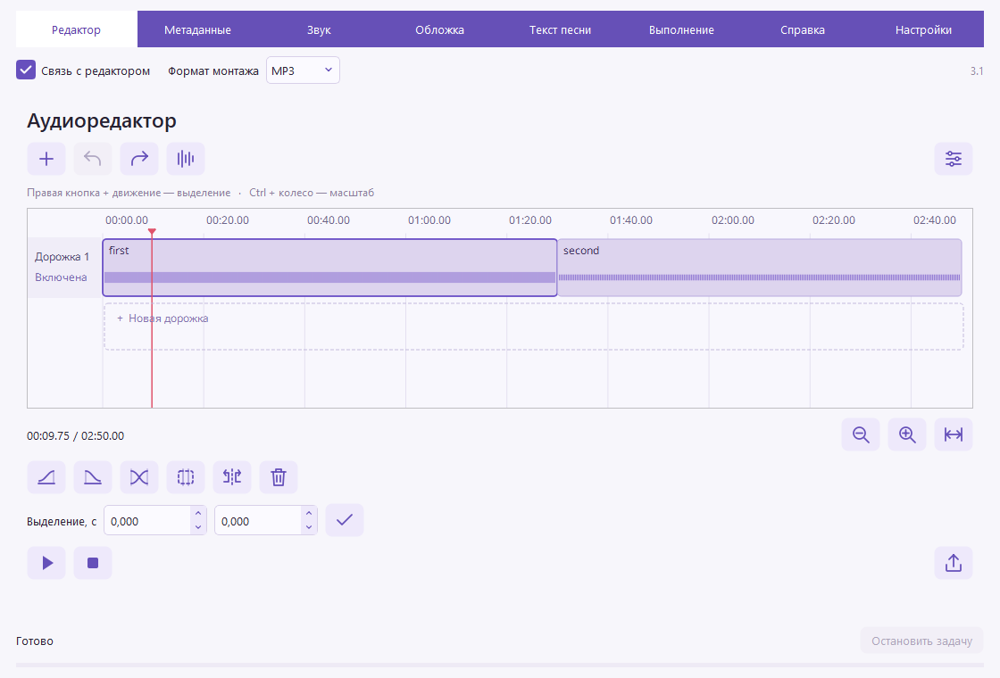
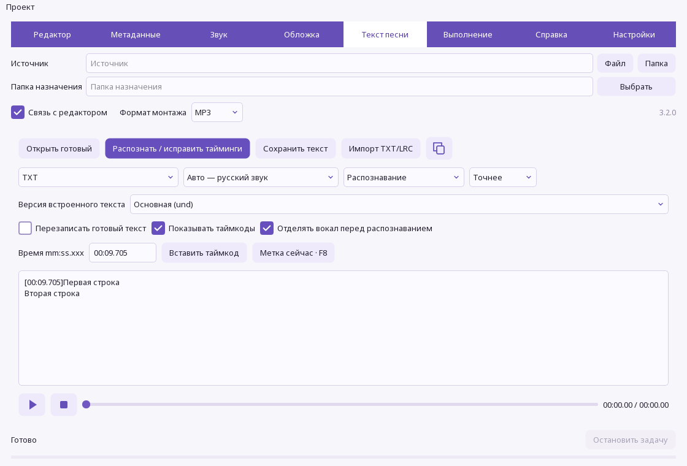

# SonicForge 3.0

Музыкальный редактор для Windows: монтаж на дорожках, обработка звука, метаданные, обложки и синхронизированный текст. Интерфейс и логика приложения переписаны на **C++20 / Qt 6**. Распознавание, разделение на инструменты и определение жанров работают локально через нативные библиотеки. Python для запуска не требуется.

[Скачать установщик](https://github.com/dumuzeyn/SonicForge/releases/download/v3.0.0/SonicForge-Setup.exe) · [Портативная версия](https://github.com/dumuzeyn/SonicForge/releases/download/v3.0.0/SonicForge-windows-x64.zip) · [Все релизы](https://github.com/dumuzeyn/SonicForge/releases)



## Возможности

- Компактная область дорожек высотой 225 px, прокрутка, перетаскивание файлов и фрагментов, отмена и повтор правок.
- Основные инструменты: плавное начало, плавный конец, переход к следующей песне той же дорожки, выделение, разделение и удаление. Переход использует перекрытие до двух секунд, измерение громкости у стыка и плавное смешивание.
- Собственные векторные иконки, подготовленные для разных масштабов экрана. Правый клик по кнопке открывает её название и описание.
- Выделение правой кнопкой мыши, масштабирование Ctrl + колесо. Дополнительные действия с фрагментом доступны через кнопку с регуляторами.
- Экспорт WAV, MP3 и M4A. Исходники монтажа сохраняются; обработка создаёт копии в выбранной папке.
- Метаданные MP3/ID3, FLAC, M4A, Ogg и Opus; встроенные обложки, сохранение существующего текста, запись TXT/LRC отдельно.
- Двухпроходная нормализация громкости, лимитер, эквалайзер, компрессор, фильтры, шумоподавление, скорость, высота тона, стереобаза, реверберация и A/B-прослушивание.
- Три семейства процедурных обложек, пользовательская палитра с перемещаемыми точками градиента, загрузка изображения и сохранение PNG.
- Редактор текста с плеером и перемоткой. **F8** ставит метку на 0,1 секунды раньше текущего звука и переходит к следующей строке. Ручное время сохраняется точно.
- Текст и таймкоды сохраняются при смене вкладок, переключении связи с редактором и правке дорожек. При коррекции таймингов сохраняются исходные слова и повторы; сопоставление использует времена слов.
- Whisper large-v3-turbo, HTDemucs для двух/четырёх составляющих и MSD musicnn для жанров. Модели включены в выпуск, их контрольные суммы проверяются.
- Русский и английский интерфейс. Настроенная палитра версии 2 переносится при первом запуске.



## Запуск

Windows 10/11 x64. Распакуйте портативный архив целиком и запустите `SonicForge/SonicForge.exe` либо используйте установщик. Отдельные Qt, FFmpeg и Python устанавливать не нужно. Для распознавания речи нужен процессор с AVX2; модели обрабатываются на CPU и требуют нескольких гигабайт свободной памяти. Скорость зависит от длительности песни и процессора.

Добавьте аудио в редактор. «Связь с редактором» передаёт текущий монтаж остальным вкладкам; при выключенной связи они используют выбранный файл. «Выполнение» применяет отмеченные этапы к копиям. Кнопка записи текста может обновить текстовый тег выбранного MP3 напрямую. Для отдельного файла выберите LRC или TXT.

Распознавание и жанровая классификация могут ошибаться. Тайминги можно уточнить вручную во время прослушивания. При недостаточном соответствии текста аудио коррекция сохраняет существующие метки или сообщает о невозможности сопоставления.

## Сборка из исходников

Нужны Git, Windows x64 и FFmpeg с `ffmpeg.exe` / `ffprobe.exe`. Основная сборка использует Qt 6.10.0 и MinGW 13.1.0. Скрипт загружает закреплённые версии движков в `build/native-deps`, собирает C++ и запускает QtTest:

```powershell
.\scripts\build_native.ps1
```

Если локальный SDK ещё не подготовлен, скрипт использует Python только как инструмент установки `aqtinstall`, CMake и Ninja в `build/native-tools`. Можно указать его явный путь через `-Python`. Приложение и нейронные рабочие процессы Python не запускают. Все обработчики рабочих процессов находятся в том же `SonicForge.exe`.

Полная сборка с обновлением единственной папки приложения, установщиком Inno Setup 6 и ZIP:

```powershell
.\scripts\build_windows.ps1 -FfmpegRoot C:\ffmpeg
```

Сборка обновляет `dist/SonicForge` на месте; дополнительные каталоги `dist-*` не создаются. Установщик имеет постоянное имя `dist/SonicForge-Setup.exe`, архив — `dist/SonicForge-windows-x64.zip`. Открытый экземпляр приложения не завершается принудительно. При миграции старый `_internal` отправляется в корзину после проверки нативного запуска.

Исходники интерфейса: `native/window.cpp` и `native/timeline.cpp`; обработка: `native/core.cpp`, `metadata.cpp`, `covers.cpp`, `neural.cpp`; оригинальные SVG-иконки: `native/icons.cpp`. Модели и движки закреплены контрольными суммами и ревизиями в `native/resources/models.json` и `native/dependencies.json`.

Архив Python-версии 2 находится в `legacy/python-v2` и не участвует в сборке и запуске версии 3. История предыдущих изменений сохранена в Git.

## Проверки

QtTest проверяет монтаж, запрет пересечений, LRC, экспорт и плавные края, переход и вырезание, нормализацию, метаданные и неизменность звука при записи тегов, обложки и транслитерацию. Диагностические режимы приложения позволяют проверить интерфейс и реальный плеер:

```powershell
.\dist\SonicForge\SonicForge.exe --smoke-test validation\ui
.\dist\SonicForge\SonicForge.exe --playback-smoke validation\speech.wav --result validation\playback.json
```

Вторая проверка воспроизводит тестовый файл без звука и проверяет старт с курсора, паузу, перемотку, обновление микса и F8. В обоих режимах приложение завершает работу после проверки.

## English

SonicForge 3.0 is a native C++20 / Qt 6 audio editor for Windows. It combines a compact multitrack editor, audio processing, metadata, procedural cover artwork and timed lyrics with playback. Recognition, stem separation and genre inference use native local engines; no Python runtime is shipped. Use right drag to select, Ctrl + wheel to zoom, and F8 in Lyrics to place a cue 100 ms before playback. Right-click an editor icon for its name and description.

## Лицензия

Собственный код и графика: [LICENSE](LICENSE), SonicForge Noncommercial and Educational License 1.0. У сторонних библиотек, моделей и шрифтов собственные лицензии: [уведомления и исходники компонентов](packaging/THIRD_PARTY_NOTICES.md).
